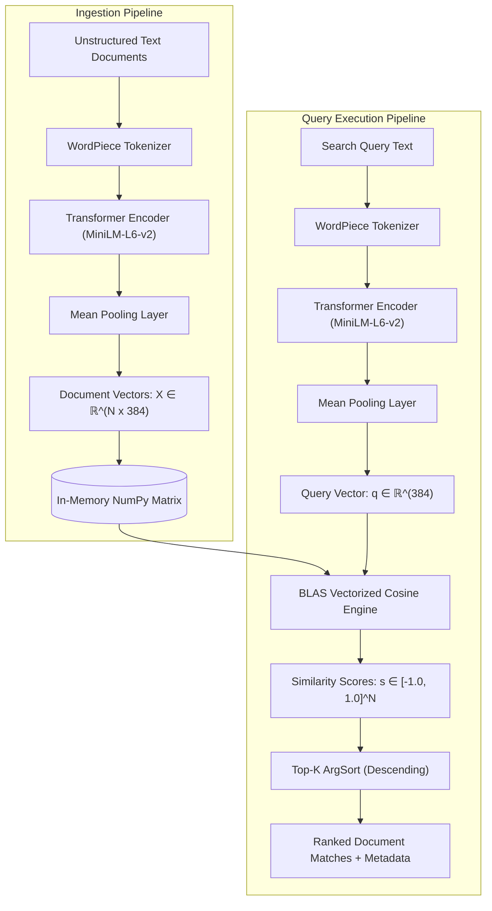

# Custom Vector Database from Scratch (`VectorDatabase`)

A high-performance, lightweight in-memory vector database implemented from first principles in Python using **NumPy** and **Sentence-Transformers**. This engine provides an exact nearest-neighbor (k-NN) dense vector search pipeline, semantic retrieval, vectorized similarity computations, and atomic persistence.

---

## 1. System Overview

Modern search systems rely on dense semantic representations rather than lexical inverted indices (such as BM25 or TF-IDF). This project implements an end-to-end vector database engine that manages the complete lifecycle of unstructured text:

1. **Embedding Generation**: Transforms variable-length natural language text into dense continuous coordinate tensors $\mathbf{x} \in \mathbb{R}^{384}$.
2. **Matrix Storage Engine**: Organizes document vectors in a contiguous C-aligned 2D NumPy matrix of shape $(N, D)$.
3. **Similarity Engine**: Computes pairwise Cosine Similarity between a query vector and the document matrix using hardware-accelerated BLAS matrix-vector operations.
4. **Ranking & Retrieval**: Implements exact k-NN retrieval using array sorting to return the top-$K$ most semantically relevant documents with their associated metadata.
5. **Persistence Layer**: Serializes high-dimensional tensors into raw binary format (`.npy`) and structured metadata into JSON (`metadata.json`).

---

## 2. Technical Architecture & Data Flow



### Ingestion Flow
1. An incoming batch of text documents $\{d_1, d_2, \dots, d_N\}$ is ingested alongside corresponding arbitrary key-value metadata dictionaries.
2. The pre-trained Transformer encoder evaluates each document in parallel, producing sequence token embeddings of shape $(L, 384)$, where $L$ is sequence length.
3. Mean pooling collapses token embeddings into fixed-size sentence vectors of shape $(1, 384)$.
4. The vectors are stacked onto the active contiguous database matrix $\mathbf{X}$ via `np.vstack`.

### Query Flow
1. A raw query string $q$ is encoded into a single vector $\mathbf{q} \in \mathbb{R}^{384}$.
2. The dot product between $\mathbf{X}$ and $\mathbf{q}$ is executed via BLAS level-2 matrix-vector multiplication (`np.dot`).
3. $L_2$ Euclidean norms are computed across axis 1 of $\mathbf{X}$ and multiplied by $\|\mathbf{q}\|_2$.
4. Numerical stability clipping ($\epsilon = 10^{-10}$) guarantees zero-division prevention.
5. Scores are sorted in $O(N \log N)$ time, yielding the top-$K$ matches and metadata records.

---

## 3. Mathematical Foundations

### Vector Representation
Given an embedding model $\mathcal{M}: \mathcal{V}^* \to \mathbb{R}^D$, any text string is projected into a $D$-dimensional real coordinate space:
$$\mathbf{x} = \mathcal{M}(\text{text}), \quad \mathbf{x} \in \mathbb{R}^{384}$$

### Metric: Cosine Similarity
Cosine Similarity computes the cosine of the angle $\theta$ between two vectors in high-dimensional space:

$$\text{sim}(\mathbf{u}, \mathbf{v}) = \cos(\theta) = \frac{\langle \mathbf{u}, \mathbf{v} \rangle}{\|\mathbf{u}\|_2 \cdot \|\mathbf{v}\|_2} = \frac{\sum_{i=1}^D u_i v_i}{\sqrt{\sum_{i=1}^D u_i^2} \cdot \sqrt{\sum_{i=1}^D v_i^2}}$$

### Vectorized Matrix Formulation
For a database matrix $\mathbf{X} \in \mathbb{R}^{N \times D}$ and query vector $\mathbf{q} \in \mathbb{R}^D$:

1. **Inner Product Vector**:
   $$\mathbf{p} = \mathbf{X} \mathbf{q} \in \mathbb{R}^N, \quad p_i = \sum_{j=1}^D X_{i,j} q_j$$

2. **Row-wise $L_2$ Norms**:
   $$\mathbf{n}_X \in \mathbb{R}^N, \quad (\mathbf{n}_X)_i = \sqrt{\sum_{j=1}^D X_{i,j}^2}$$
   $$n_q = \|\mathbf{q}\|_2 = \sqrt{\sum_{j=1}^D q_j^2}$$

3. **Denominator Matrix with Epsilon Stabilization**:
   $$\mathbf{d} = \max\left(\mathbf{n}_X \cdot n_q, \; \epsilon\right), \quad \epsilon = 10^{-10}$$

4. **Pairwise Similarity Scores**:
   $$\mathbf{s} = \frac{\mathbf{p}}{\mathbf{d}} \in [-1.0, 1.0]^N$$

---

## 4. Technical Specifications & API Reference

### Embedding Model Configuration
- **Model Identifier**: `sentence-transformers/all-MiniLM-L6-v2`
- **Architecture**: 6-layer BERT Transformer Encoder (MiniLM distillation)
- **Output Dimensionality**: $D = 384$
- **Max Input Sequence Length**: 256 WordPiece tokens
- **Data Type**: 32-bit single-precision floating point (`float32`)

---

### Class: `VectorDatabase`

```python
class VectorDatabase(model_name: str = "all-MiniLM-L6-v2")
```

#### `__init__(model_name: str = "all-MiniLM-L6-v2")`
Initializes the vector database instance and loads the Transformer model weights into memory.
- **Parameters**:
  - `model_name` (*str*): Hugging Face repository ID or local path to a Sentence-Transformers compatible model.
- **Attributes Initialized**:
  - `self.documents`: List of stored raw document strings (`List[str]`).
  - `self.metadatas`: List of document-level metadata dictionaries (`List[Dict[str, Any]]`).
  - `self.embeddings`: 2D NumPy array of shape $(N, 384)$ or `None`.

#### `add_documents(documents: List[str], metadatas: Optional[List[Dict[str, Any]]] = None) -> None`
Encodes a list of raw texts and vertically stacks their representations into the active matrix.
- **Parameters**:
  - `documents` (*List[str]*): Array of raw text strings to index.
  - `metadatas` (*Optional[List[Dict[str, Any]]]*): Optional metadata mappings. Length must match `len(documents)`.
- **Complexity**:
  - Time: $O(N \cdot L \cdot D)$ (dominated by Transformer attention forward-pass)
  - Memory: $O(N \cdot D \times 4\text{ bytes})$

#### `cosine_similarity(query_vec: np.ndarray, doc_vecs: np.ndarray) -> np.ndarray` (Static Method)
Performs vectorized Cosine Similarity computation using optimized BLAS primitives.
- **Parameters**:
  - `query_vec` (*np.ndarray*): Query vector of shape `(D,)` or `(1, D)`.
  - `doc_vecs` (*np.ndarray*): Document matrix of shape `(N, D)`.
- **Returns**:
  - `scores` (*np.ndarray*): 1D array of shape `(N,)` containing similarity values bounded in $[-1.0, 1.0]$.

#### `query(query_text: str, top_k: int = 3) -> List[Dict[str, Any]]`
Encodes a query string and returns the top-$K$ most semantically aligned documents.
- **Parameters**:
  - `query_text` (*str*): Natural language search prompt.
  - `top_k` (*int*): Number of highest-ranked results to retrieve.
- **Returns**:
  - List of structured dictionaries containing:
    ```python
    {
        "score": float,     # Cosine similarity in range [-1.0, 1.0]
        "document": str,    # Original stored text string
        "metadata": dict    # Associated metadata dictionary
    }
    ```

#### `save(directory_path: str) -> None`
Serializes the database state to disk.
- **Artifacts Created**:
  - `vectors.npy`: Raw binary format containing the $(N, 384)$ `float32` matrix.
  - `metadata.json`: UTF-8 encoded JSON containing `documents` and `metadatas`.

#### `load(directory_path: str) -> None`
Reconstructs the database state from persisted disk artifacts.
- **Parameters**:
  - `directory_path` (*str*): Path containing `vectors.npy` and `metadata.json`.

---

## 5. Algorithmic Complexity & Scaling Analysis

### Computational Complexity

| Operation | Time Complexity | Auxiliary Space | Bottleneck Driver |
| :--- | :--- | :--- | :--- |
| **Document Ingestion** | $O(N \cdot L \cdot D)$ | $O(N \cdot D)$ | Transformer self-attention layers ($L = \text{sequence length}$) |
| **Query Embedding** | $O(L_{\text{query}} \cdot D)$ | $O(D)$ | Model forward pass |
| **Dot Product ($\mathbf{X} \mathbf{q}$)** | $O(N \cdot D)$ | $O(N)$ | BLAS Level 2 matrix-vector kernel |
| **Norm Reductions** | $O(N \cdot D)$ | $O(N)$ | Row-wise Euclidean summation |
| **Top-$K$ Extraction** | $O(N \log N)$ | $O(N)$ | `np.argsort` Quicksort pass |

### Memory Scaling Profile

Because embeddings use IEEE 754 single-precision floats (`float32`), each dimension consumes exactly 4 bytes of memory:
$$\text{Memory Footprint} = N \times 384 \times 4 \text{ bytes}$$

| Stored Documents ($N$) | Vector Dimension ($D$) | Raw Vector RAM | Total RAM with Overhead | Query Latency (CPU) |
| :--- | :--- | :--- | :--- | :--- |
| **1,000** | 384 | 1.54 MB | ~5 MB | < 2 ms |
| **10,000** | 384 | 15.36 MB | ~25 MB | ~5 ms |
| **100,000** | 384 | 153.60 MB | ~220 MB | ~35 ms |
| **1,000,000** | 384 | 1.54 GB | ~2.1 GB | ~350 ms |

---

## 6. Exact Search (k-NN) vs. Approximate Nearest Neighbors (ANN)

This implementation performs **Exact Nearest Neighbor search (Flat Index)**, which guarantees 100% recall accuracy. As collections scale to millions of vectors, production systems trade small recall margins for logarithmic latency using Approximate Nearest Neighbor (ANN) index structures:

```
┌────────────────────────────────────────────────────────┐
│                      Flat Index (k-NN)                 │
│  - Recall: 100% (Exact ground truth)                   │
│  - Query Time: O(N * D) (Linear scan)                  │
│  - Ideal for: Datasets < 200,000 vectors               │
└──────────────────────────┬─────────────────────────────┘
                           │
                           ▼ Scaling to Millions of Vectors
┌────────────────────────────────────────────────────────┐
│            Approximate Nearest Neighbors (ANN)         │
│  - Graph-based: HNSW (Hierarchical Navigable Small     │
│    World graphs) -> O(log N) traversal latency.        │
│  - Inverted File: IVF (Voronoi centroid partitioning). │
│  - Compression: Product Quantization (PQ) 8x-16x RAM.  │
└────────────────────────────────────────────────────────┘
```

---

## 7. Installation & Quickstart

### Prerequisites
- Python 3.10 or higher
- Windows, macOS, or Linux

### 1. Environment Setup

```bash
# Clone or navigate into repository
cd custom-vector-db-from-scratch

# Create isolated virtual environment
python -m venv .venv
```

Activate the environment:
- **Windows (PowerShell)**:
  ```powershell
  .\.venv\Scripts\Activate.ps1
  ```
- **macOS / Linux**:
  ```bash
  source .venv/bin/activate
  ```

### 2. Install Dependencies

```bash
pip install -r requirements.txt
```

### 3. Run Benchmark & Demonstration

```bash
python vector_db.py
```

---

## 8. Programmatic Usage Example

```python
from vector_db import VectorDatabase

# 1. Instantiate the database
db = VectorDatabase(model_name="all-MiniLM-L6-v2")

# 2. Ingest corpus documents with structured metadata
corpus = [
    "Quantum computing leverages superposition and entanglement to perform complex computations.",
    "A margherita pizza consists of a simple crust, San Marzano tomato sauce, and fresh mozzarella.",
    "Dolphins use echolocation to navigate underwater environments and hunt schools of fish."
]

metadata = [
    {"domain": "physics", "id": 101},
    {"domain": "culinary", "id": 102},
    {"domain": "marine_biology", "id": 103}
]

db.add_documents(documents=corpus, metadatas=metadata)

# 3. Execute semantic search
query = "What Italian dish has dough and melted cheese?"
results = db.query(query_text=query, top_k=2)

for rank, item in enumerate(results, 1):
    print(f"Rank {rank} [Score: {item['score']:.4f}]: {item['document']}")
    print(f"   Metadata: {item['metadata']}")

# 4. Persist to disk
db.save("db_storage")

# 5. Reload in a new instance
new_db = VectorDatabase()
new_db.load("db_storage")
```

---

## 9. Directory Structure

```text
custom-vector-db-from-scratch/
├── .gitignore               # Ignores runtime artifacts and virtual environments
├── requirements.txt         # Runtime requirements (numpy, sentence-transformers)
├── vector_db.py             # Core vector database engine and search demo
├── README.md                # System documentation and technical specification
└── sample_docs/             # Benchmark text documents partitioned by topic
    ├── animals.txt          # Biological and zoological observations
    ├── food.txt             # Gastronomic and culinary descriptions
    └── space.txt            # Astronomical and astrophysical observations
```
